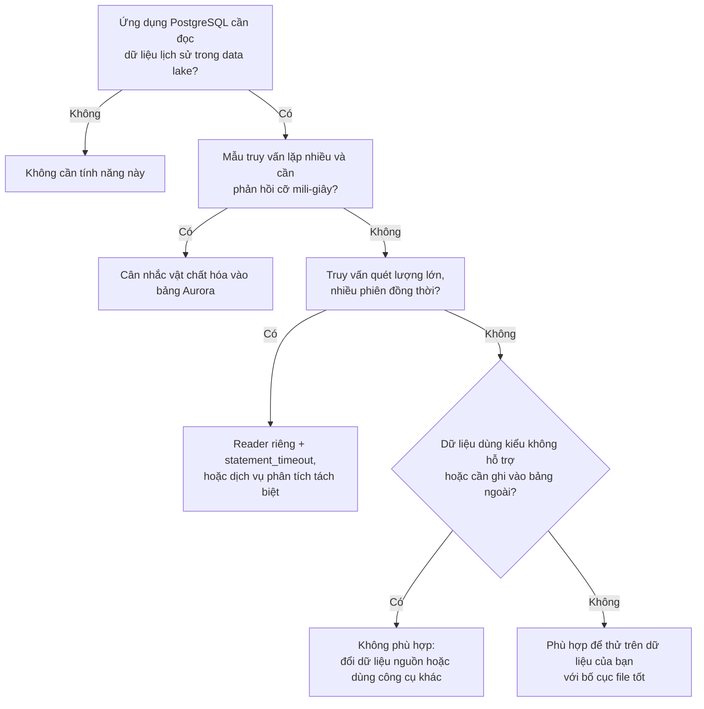

# Aurora PostgreSQL nhúng DuckDB: đọc data lake không cần ETL, và những cái giá đi kèm

> **Phạm vi bài viết:** đây là bài phân tích từ tài liệu chính thức của AWS (tra cứu ngày 14/10/2026). Tác giả chưa chạy thực nghiệm, nên bài không có số đo hiệu năng hay chi phí. Mọi nhận định đều được đánh dấu là nhận định, và phần "Điều bài này chưa chứng minh" ở cuối nói rõ còn thiếu gì.

Hãy hình dung một tình huống giả định: một ứng dụng bán hàng chạy trên PostgreSQL, và màn hình hỗ trợ khách cần hiện cả đơn hàng đang xử lý lẫn lịch sử mua hàng nhiều năm. Đơn hàng nằm trong cơ sở dữ liệu vận hành. Lịch sử nằm trong các file Parquet trên S3, do nhóm dữ liệu quản lý.

Cách quen thuộc là sao chép lịch sử vào cơ sở dữ liệu bằng một đường ống dữ liệu. Nó chạy được, nhưng tài liệu của AWS mô tả khá thẳng cái giá: dữ liệu bị nhân đôi, chi phí hạ tầng tăng, và phải có người duy trì để hai bản luôn khớp nhau khi schema thay đổi.

Ngày 30/9/2026, AWS công bố một hướng khác cho Amazon Aurora PostgreSQL. Bài này đi qua tính năng đó theo hướng của một người học Data Analytics: nó làm gì, hoạt động ra sao, khi nào hợp, và cái giá phải trả là gì.

## 1. AWS đã công bố điều gì

Theo [bài đăng trên AWS News Blog](https://aws.amazon.com/blogs/aws/amazon-aurora-postgresql-now-supports-direct-querying-of-apache-iceberg-and-parquet-data-in-your-data-lake/) ngày 30/9/2026 và [tài liệu Aurora](https://docs.aws.amazon.com/AmazonRDS/latest/AuroraUserGuide/query-iceberg-and-parquet-data.html):

- Aurora PostgreSQL có thể truy vấn trực tiếp dữ liệu Apache Iceberg và Parquet trong data lake, cùng lúc với dữ liệu vận hành, qua cùng endpoint và driver mà ứng dụng đang dùng.
- Cơ chế là tạo **foreign table** (bảng ngoài) trỏ tới dữ liệu trên Amazon S3, Amazon S3 Tables hoặc AWS Glue Data Catalog, rồi truy vấn bằng SQL thông thường. Có thể kết hợp bảng ngoài với bảng Aurora trong một truy vấn.
- Qua liên kết (federation) với Glue Data Catalog, Aurora cũng đọc được bảng Iceberg nằm trong các catalog tương thích Iceberg REST Catalog bên ngoài AWS.
- Điều kiện: Aurora PostgreSQL **17.11 trở lên** hoặc **18.6 trở lên**, kể cả Aurora Serverless v2.
- Bên dưới là **DuckDB**, một engine phân tích dạng cột mã nguồn mở, được nhúng ngay trong máy chủ PostgreSQL.
- Không tính thêm phí để bật tính năng; bạn trả tiền cho phần compute Aurora và request S3 phát sinh từ các truy vấn.

Về bối cảnh thương vụ: bài đăng của AWS cho biết DuckLabs, nhóm phát triển DuckDB, đã gia nhập Amazon gần đây. Theo [thông báo của Amazon](https://www.aboutamazon.com/news/company-news/aws-ducklabs) ngày 26/8/2026, thứ AWS mua là công ty, không phải dự án mã nguồn mở: DuckDB vẫn giữ giấy phép MIT và thuộc DuckDB Foundation phi lợi nhuận.

## 2. Hai kiến trúc, đặt cạnh nhau

*Sơ đồ khái niệm vẽ theo tài liệu AWS, không phải kết quả đo. Không dùng biểu tượng chính thức của AWS.*

Điểm khác biệt cốt lõi là **dữ liệu không dịch chuyển**. Ở kiến trúc cũ, dữ liệu lịch sử được sao chép vào Aurora trước khi ai đó truy vấn. Ở kiến trúc mới, dữ liệu vẫn nằm trên S3 và Aurora đọc nó khi có truy vấn. Công việc không biến mất; nó đổi chỗ từ đường ống dữ liệu sang compute của Aurora.

## 3. Bên trong: bốn loại tài nguyên

Theo [trang Resource management](https://docs.aws.amazon.com/AmazonRDS/latest/AuroraUserGuide/aurora-analytics-resource-management.html), truy vấn trên bảng ngoài dùng bốn loại tài nguyên:

| Tài nguyên | Vai trò | Điều đáng biết |
|---|---|---|
| **Query memory** | Bộ nhớ làm việc cho hash table, sắp xếp, gộp nhóm; điều khiển bằng tham số `aurora_analytics.query_mem` | Mặc định lấy từ bộ nhớ instance; bị chặn trên bởi bộ nhớ instance trừ đi phần dành cho `shared_buffers` |
| **Disk spilling** | Khi vượt bộ nhớ, ghi dữ liệu trung gian ra đĩa cục bộ | Truy vấn vẫn chạy nhưng chậm hơn; có thể vẫn hết chỗ và lỗi |
| **Worker threads** | Song song hóa trên CPU | Aurora tự quản, bạn không cấu hình |
| **On-disk read cache** | Lưu đệm dữ liệu S3 trên đĩa cục bộ (NVMe hoặc EBS) | Lần đọc đầu có độ trễ mạng tới S3; xóa sạch khi instance khởi động lại hoặc failover |

Hai chi tiết về bộ nhớ và cache có hệ quả thực tế:

- `shared_buffers` mặc định chiếm khoảng hai phần ba bộ nhớ instance, nhưng truy vấn trên bảng ngoài **không dùng** `shared_buffers`. Vì vậy phần bộ nhớ khả dụng cho chúng nhỏ hơn nhiều so với tổng bộ nhớ, trừ khi bạn chỉnh lại.
- Về độ tươi của dữ liệu: file Parquet mới thêm vào cùng prefix S3 được phát hiện ở truy vấn kế tiếp; với Iceberg, cache không ảnh hưởng đến snapshot bạn thấy. Nhưng nếu ghi đè một file Parquet đã có, kết nối đang mở có thể đọc dữ liệu cũ trong chốc lát vì giữ handle file đã cache; kết nối lại là thấy dữ liệu mới.

## 4. Cái giá phải trả

Đây là phần mà tin ra mắt thường lướt qua, trong khi tài liệu AWS lại nói khá rõ.

**a. Tranh chấp tài nguyên trên cùng instance.** Khi một truy vấn tràn bộ nhớ, dữ liệu trung gian được ghi ra cùng ổ lưu trữ cục bộ mà read cache đang dùng. Tài liệu cảnh báo rằng với instance chạy tải hỗn hợp, spill nặng có thể tạo tranh chấp I/O ảnh hưởng gián tiếp đến các thao tác PostgreSQL cục bộ. Ngoài ra còn có cơ chế bảo vệ bộ nhớ: khi áp lực bộ nhớ toàn hệ thống lên mức nguy hiểm, Aurora hủy truy vấn đang chạy để giữ cho instance ổn định.

**b. Reader riêng và một cái bẫy ít người ngờ.** Để tách tải phân tích khỏi tải giao dịch, [trang Dedicated reader](https://docs.aws.amazon.com/AmazonRDS/latest/AuroraUserGuide/aurora-analytics-dedicated-reader.html) khuyên chạy truy vấn bảng ngoài trên một reader riêng, đặt mức ưu tiên failover thấp nhất (promotion tier 15), và kết nối bằng instance endpoint hoặc custom endpoint thay vì reader endpoint chung. Nhưng chuyển sang reader không làm vấn đề biến mất: một truy vấn chạy lâu trên reader giữ chân việc dọn dead tuple (vacuum) trên writer, nên dead tuple tích tụ và làm writer chậm dần. Tài liệu đề nghị đặt `statement_timeout` cho reader và theo dõi `oldest_reader_feedback_xid_age` trên writer. Đây là kiểu rủi ro mà chỉ đọc tên tính năng sẽ không thấy.

**c. Chi phí chuyển dạng chứ không biến mất.** Nhờ không phải xây và vận hành đường ống, bạn tiết kiệm công sức và dung lượng lưu trữ bản sao. Đổi lại, mỗi truy vấn đọc S3 tốn compute Aurora và request S3. Truy vấn lặp lại nhiều lần trên cùng dữ liệu được cache, nhưng cache mất khi khởi động lại hoặc failover. Với Aurora Serverless v2, tài liệu cũng lưu ý nhiều truy vấn phân tích nặng chạy đồng thời có thể vượt tốc độ instance mở rộng.

**d. Giới hạn chức năng.** Theo [trang Limitations](https://docs.aws.amazon.com/AmazonRDS/latest/AuroraUserGuide/aurora-analytics-limitations.html):
- Bảng ngoài **chỉ đọc**; không `INSERT`, `UPDATE`, `DELETE`, `TRUNCATE`, `COPY FROM`.
- Một số kiểu dữ liệu không có ánh xạ: `JSONB`, `SERIAL`, mảng, kiểu mạng, kiểu khoảng, kiểu hình học, `XML`.
- Tên cột suy ra từ metadata không quá 63 ký tự; không có hai cột chỉ khác nhau chữ hoa/thường; collation chỉ hỗ trợ `C` và `ICU`.
- Một truy vấn không đọc dữ liệu từ nhiều Region AWS; không truy cập được cột hệ thống như `ctid`, `xmin`.

## 5. Vì sao bố cục dữ liệu quyết định nhiều thứ

AWS nói tính năng dùng predicate pushdown và column pruning. Hai ý này có gốc từ cách Parquet tổ chức dữ liệu (nguyên lý chung của định dạng, không phải điều tôi đo trên Aurora):

- Parquet lưu theo **cột**, nên truy vấn chỉ cần vài cột thì engine không phải đọc phần còn lại. Đó là column pruning.
- Dữ liệu được chia thành các **row group**, mỗi nhóm kèm thống kê min/max của từng cột. Nếu một row group không thể chứa giá trị đang lọc, engine bỏ qua cả nhóm. Đó là predicate pushdown.

Vì vậy [trang Data layout](https://docs.aws.amazon.com/AmazonRDS/latest/AuroraUserGuide/aurora-analytics-data-layout.html) đưa ra ba hướng dẫn: tránh quá nhiều file nhỏ (tăng overhead metadata và request S3), chọn kích thước row group hợp lý (quá nhỏ thì tốn overhead, quá lớn thì khó bỏ qua chính xác), và phân vùng theo cột hay dùng để lọc. Ý nghĩa với người làm dữ liệu: **bạn có thể kiểm soát một phần chi phí truy vấn từ lúc ghi file**, trước khi Aurora chạy bất kỳ câu SQL nào.

## 6. Khi nào hợp, khi nào chưa

Phần này là nhận định của tôi, đặt trên các use case mà [tài liệu AWS](https://docs.aws.amazon.com/AmazonRDS/latest/AuroraUserGuide/query-iceberg-and-parquet-data.html) nêu (làm giàu truy vấn vận hành, tầng hóa dữ liệu, đơn giản hóa kiến trúc, ứng dụng AI agent) và trên các giới hạn ở mục 4.

| Tình huống | Nhận định | Lý do |
|---|---|---|
| Truy vấn vận hành cần thêm ngữ cảnh lịch sử, lọc chọn lọc | Có vẻ hợp | Đúng với use case "làm giàu truy vấn"; dữ liệu đọc ít |
| Giữ dữ liệu nóng trong Aurora, đẩy dữ liệu nguội ra lake | Có vẻ hợp | Đúng với use case tầng hóa; giảm kích thước DB, chi phí lưu trữ và sao lưu |
| Cần độ trễ rất thấp cho một mẫu truy vấn lặp lại | Nên vật chất hóa | AWS gợi ý nạp dữ liệu vào bảng Aurora bằng `CREATE TABLE AS SELECT`, `INSERT INTO ... SELECT`, `MERGE INTO` |
| Nhiều phiên phân tích quét lượng lớn, join lớn không lọc | Cần cân nhắc kỹ | Dễ spill, tranh chấp tài nguyên, bị hủy truy vấn |
| Cần ghi lại vào dữ liệu lake từ Aurora | Không hợp | Bảng ngoài chỉ đọc |
| Dữ liệu dùng kiểu `JSONB`, mảng, `XML` | Cần chuyển đổi nguồn | Không có ánh xạ kiểu |

## 7. Đặt cạnh các lựa chọn khác

Bảng này so sánh về mặt khái niệm, không có số đo:

| Phương án | Tính toán chạy ở đâu | Kết hợp với dữ liệu vận hành | Rủi ro chính (nhận định) |
|---|---|---|---|
| ETL sao chép vào Aurora | Trong Aurora, sau khi dữ liệu đã được sao chép | Dễ, vì dữ liệu đã nằm trong DB | Nhân đôi dữ liệu, vận hành đường ống, độ trễ đồng bộ |
| Aurora đọc trực tiếp (tính năng mới) | Trong Aurora, đọc từ S3 khi truy vấn | Trong một truy vấn SQL | Chia sẻ tài nguyên với tải giao dịch; giới hạn kiểu dữ liệu |
| Dịch vụ truy vấn tách biệt như Athena | Ngoài cơ sở dữ liệu vận hành | Phải kết hợp ở tầng khác | Thêm một dịch vụ để quản lý; không join trực tiếp với bảng Aurora trong một câu SQL |
| DuckDB chạy trên máy cá nhân | Trên máy bạn | Không nối trực tiếp tới Aurora | Phù hợp khám phá, không phải phục vụ ứng dụng |

## 8. Điều bài này chưa chứng minh

- **Chưa có số đo** về tốc độ của Aurora so với Athena hay DuckDB cục bộ trên cùng dữ liệu.
- **Chưa biết điểm hòa vốn chi phí:** khi nào việc trả compute Aurora cho mỗi lần đọc rẻ hơn hoặc đắt hơn đường ống ETL, vì điều đó phụ thuộc quy mô dữ liệu, tần suất truy vấn và giá Region.
- **Chưa kiểm chứng hành vi ở quy mô lớn** hoặc dưới tải đồng thời, nơi mà mục 4 cho thấy rủi ro tập trung.
- Tính năng mới ra mắt; tài liệu và giới hạn có thể được cập nhật. Hãy đối chiếu lại các trang nguồn trước khi dựa vào chúng.

Muốn kiểm chứng, một cách rẻ nhất là thử DuckDB trên máy cá nhân với vài file Parquet có bố cục khác nhau để thấy pushdown và pruning hoạt động. Phép thử đó chưa nói gì về Aurora, nhưng giúp hiểu cơ chế.

## 9. Điều người học Data Analytics nên giữ lại

1. **SQL vẫn là giao diện chung.** Công cụ đổi, nhưng khả năng viết truy vấn đúng, lọc sớm, chọn đúng cột thì dùng được ở mọi nơi.
2. **Định dạng và bố cục file là kỹ năng phân tích dữ liệu**, không chỉ của kỹ sư dữ liệu: Parquet, row group, phân vùng, Iceberg.
3. **Đọc tài liệu giới hạn trước khi đọc quảng bá.** Những gì quyết định một công nghệ có hợp bài toán của bạn hay không thường nằm ở các trang như Limitations và Resource management.
4. **Tư duy chi phí:** mỗi giải pháp chuyển chi phí từ chỗ này sang chỗ khác. Hãy hỏi chi phí đó nằm ở đâu thay vì hỏi nó có biến mất không.

## Kết luận

Aurora PostgreSQL nhúng DuckDB giải một vấn đề có thật: bớt đường ống sao chép và cho phép một câu SQL chạm cả dữ liệu vận hành lẫn data lake. Nhưng theo chính tài liệu AWS, nó không miễn phí theo nghĩa rộng: bạn trả bằng compute, request S3, và sự chú ý đến tranh chấp tài nguyên, dead tuple trên writer cùng các giới hạn kiểu dữ liệu. Câu hỏi đáng đặt trước khi dùng không phải "nó nhanh không", mà là "tải truy vấn của tôi có hợp với những đánh đổi này không". Bài này chỉ giúp đặt câu hỏi đó cho chính xác; câu trả lời cần số đo trên dữ liệu thật.

## Nguồn tham khảo (tra cứu 14/10/2026)

- AWS News Blog, "Amazon Aurora PostgreSQL now supports direct querying of Apache Iceberg and Parquet data in your data lake", 30/9/2026: https://aws.amazon.com/blogs/aws/amazon-aurora-postgresql-now-supports-direct-querying-of-apache-iceberg-and-parquet-data-in-your-data-lake/
- Tài liệu Aurora, tổng quan: https://docs.aws.amazon.com/AmazonRDS/latest/AuroraUserGuide/query-iceberg-and-parquet-data.html
- Tài liệu Aurora, Resource management: https://docs.aws.amazon.com/AmazonRDS/latest/AuroraUserGuide/aurora-analytics-resource-management.html
- Tài liệu Aurora, Dedicated reader: https://docs.aws.amazon.com/AmazonRDS/latest/AuroraUserGuide/aurora-analytics-dedicated-reader.html
- Tài liệu Aurora, Data layout: https://docs.aws.amazon.com/AmazonRDS/latest/AuroraUserGuide/aurora-analytics-data-layout.html
- Tài liệu Aurora, Limitations: https://docs.aws.amazon.com/AmazonRDS/latest/AuroraUserGuide/aurora-analytics-limitations.html
- Amazon News, "AWS to acquire DuckLabs, the Amsterdam-based company behind DuckDB", 26/8/2026: https://www.aboutamazon.com/news/company-news/aws-ducklabs
