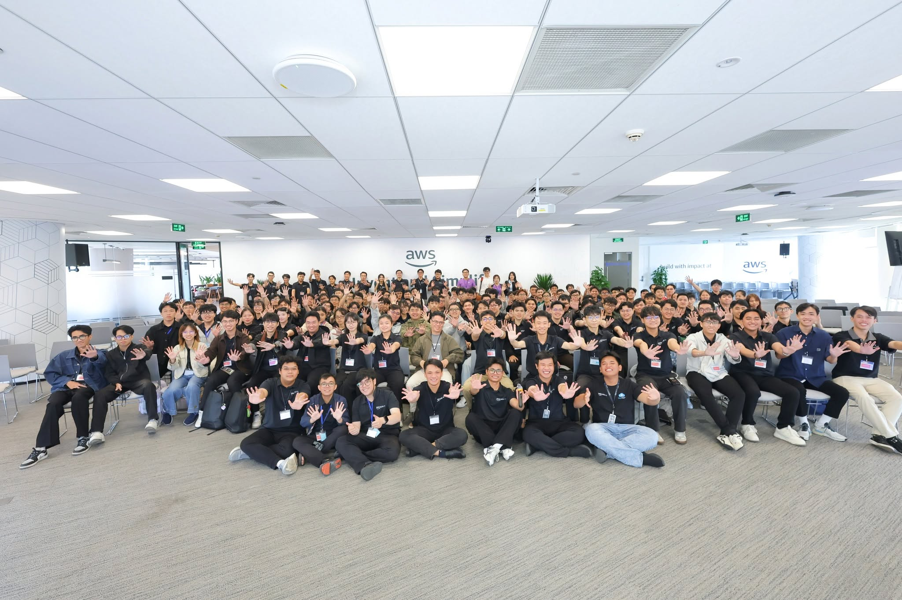
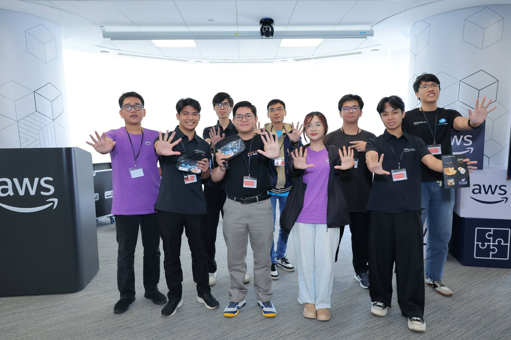

# Summary Report: "First Cloud AI Journey Community Day"

### Event Objectives

- Learn from speakers across different companies and from fellow interns in the First Cloud Journey program.
- Explore practical topics in **AI-assisted software development, serverless architecture, asynchronous systems, cloud education, internships, and open source**.
- Understand how to start learning AWS effectively and how to use AWS community resources.
- Learn how to prepare for a career in cloud computing and connect with the community.

### Event Highlights

#### Lessons from Building Software Factories

- Speaker: **Henry Đức Bùi, Head of Engineering at Cloudthinker**, with the talk *Listen, Learn and Form: Building Software Factory*.
- Focused on applying AI across the whole **Software Development Lifecycle (SDLC)**, not on a specific product.
- A team of about **5–6 people** completed nearly **3,000 merge requests in one month** (around 100 per day), most of them driven by AI, roughly **3x** the previous month.
- Described three types of companies: startups hesitant to invest in AI, big tech with large token budgets but cautious about AI breaking systems, and companies that spend **200–400 USD per employee** on AI subscriptions.
- When tokens are no longer a constraint, the question shifts from optimizing token usage to getting the most productivity from the team.

#### Education

- A session from an educator's perspective on preparing the next generation of cloud talent.
- Covered what students should prepare before entering the industry and how to narrow the gap between universities and businesses.

#### AWS Lambda Web Functions

- Covered native HTTP support and handling up to **128 concurrent requests**, which changes how serverless web applications can be designed.
- Discussed removing adapter overhead and using active CPU billing for better cost efficiency.
- Compared serverless with Docker on EC2/ECS through live performance tests.

#### Amazon SQS: Building Asynchronous Systems

- Explained why modern systems need asynchronous processing.
- Showed how Amazon SQS helps decouple and scale an architecture.
- Shared design patterns and practical tips for implementation.

#### My AWS Internship Journey

- Speaker: **Trần Minh Tuấn**, FPT University student and back-end developer, sharing a learning roadmap for AWS beginners after 1.5 months of his 3-month internship.
- Introduced three resources: **AWS Study Group** (step-by-step labs in Vietnamese), **AWS Skill Builder** (courses, Cloud Practitioner with 13 modules, exam prep, Cloud Quest, Builder Labs) and **AWS Builder Center** (community, articles, hackathons, Student Builder groups).
- Suggested roadmap: learn the fundamentals on Skill Builder, practice labs on Study Group, note errors, build a small project, then write an article for Builder Center.
- Shared a lab habit: always **clean up resources**. One teammate used up a 200 USD credit and reached about 760 USD in a week by forgetting to clean up.
- Explained student verification (about 3 days, no .edu email needed) and the badge system that unlocks credits and a certification exam voucher.

#### Getting Started with Open Source

- Covered how to make a first open source contribution from scratch.
- Discussed building a consistent contribution habit and staying motivated.
- Talked about the impact of open source on skills and career growth.

### Key Takeaways

#### Learning Mindset

- Combine theory (Skill Builder), hands-on labs (Study Group) and community (Builder Center) instead of relying on only one.
- Record errors and lessons from each lab, then turn them into small projects and articles.
- Paid options are optional; the free content is enough to begin.

#### Engineering Perspective

- Asynchronous processing and serverless are important tools for building scalable systems.
- Cost awareness matters: always clean up cloud resources after labs.
- AI can greatly increase development throughput when it is built into the whole development process.

#### Future of Technology

- AI-assisted development is changing how small teams deliver software.
- Companies are moving from limiting AI usage to using it at scale.
- Cloud skills, community involvement and open source contributions all support career growth.

### Applying to Work

- Follow the suggested roadmap: Skill Builder, then labs, then a small project and an article.
- Always clean up AWS resources after labs to avoid unexpected costs.
- Explore AWS Lambda and Amazon SQS in my own projects.
- Try AI tools in more stages of my development workflow, not only for writing code.
- Start contributing to open source and share what I learn on AWS Builder Center.

### Event Experience

Attending **First Cloud AI Journey Community Day** gave me a broad view of the cloud and AI community, from technical talks to practical advice from fellow interns.

#### Learning from the Speakers

- The software factory talk showed how far AI can change the productivity of a small team.
- The technical sessions on Lambda and SQS gave practical ideas for designing serverless and asynchronous systems.

#### Learning from Fellow Interns

- Hearing from an intern who was only a few weeks ahead made the AWS learning path feel clear and achievable.
- The tips on labs, cost control, student verification and badges are practical and easy to apply.

#### Lessons Learned

- Consistency matters more than intensity, whether it is learning AWS, writing articles or contributing to open source.
- Controlling cost is part of working responsibly with the cloud.
- Learning is faster when it is shared with a community.

### Some Event Photos

