# Guide to Creating an ECS Cluster and Configuring Task Definition

## 1. Create ECS Cluster

**Step 1:** Log in to the AWS Console, search for and access the **Amazon Elastic Container Service (ECS)**. On the left menu bar, select **Clusters**.

**Step 2:** On the main interface, click the orange **Create cluster** button.

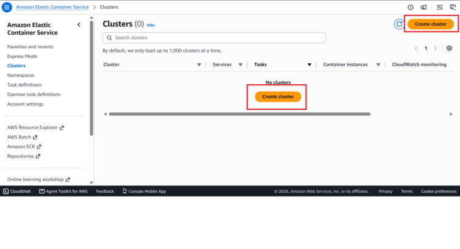

**ECS Cluster Configuration:**
In the **Cluster configuration** section, configure:
- **Cluster name:** `RakiBookery-cluster`
- **Infrastructure:** Fargate only

**Step 3:** In the Cluster configuration section, enter the cluster name in the Cluster name field as `RakiBookery-cluster`.

**Step 4:** Scroll down to the **Infrastructure - advanced** section, and select the Compute capacity type as **Fargate only**. (This is a Serverless environment; you don't need to worry about provisioning or managing EC2 instances).

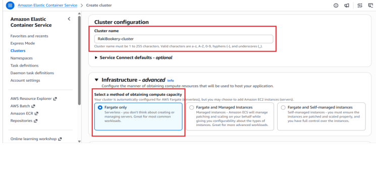

**Step 5:** Keep other optional parameters as default, scroll to the bottom of the page, and click the **Create** button to proceed with creating the cluster.

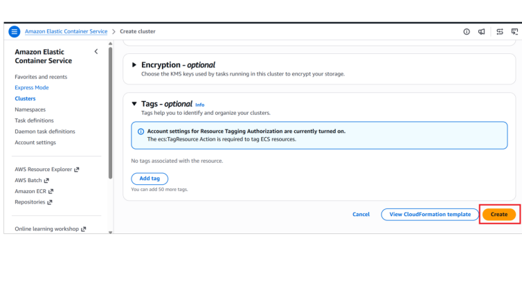

**Step 6:** Wait a moment, and the system will display a green notification bar "Cluster RakiBookery-cluster has been created successfully", confirming that the Cluster has been initialized.

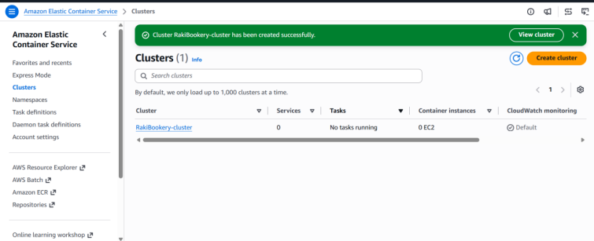

## 2. Create Task Definition

**Step 1:** On the left menu of the ECS service, select **Task definitions**.

**Step 2:** Click the **Create new task definition** button (you can also select this via the dropdown menu).

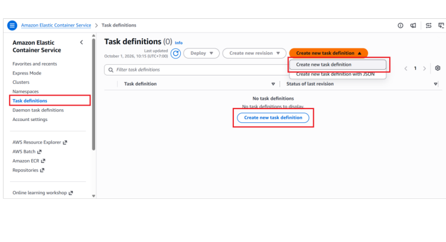

**Task Definition Configuration:**

**Step 3:** In the **Task definition configuration** section, enter a name for the task in the Task definition family field (e.g., `RakiBookery-task`).

**Step 4:** In the **Infrastructure requirements** section, check the **AWS Fargate** box under Launch type.

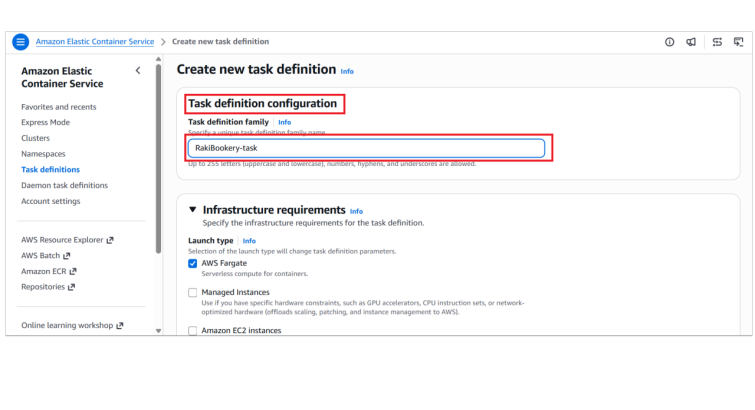

**Step 5:** Configure server resources with the following parameters:
- **Operating system/Architecture:** Select `Linux/X86_64`.
- **CPU:** Select `.25 vCPU`.
- **Memory:** Select `1 GB`.

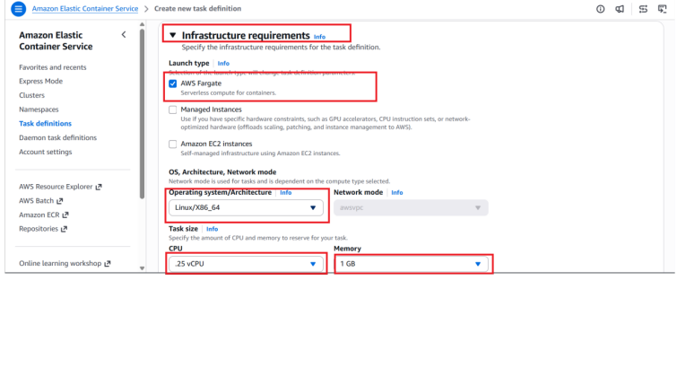

**Step 6:** In the **Container - 1** configuration section:
- **Name:** Name the container (e.g., `Main`).
- **Essential container:** Select `Yes`.
- **Image URI:** Paste the image URI you pushed to ECR (e.g., `147956724787.dkr.ecr.ap-southeast-1.amazonaws.com/rakibookery:latest`).
- **Port mappings:** Enter `80` for Container port, `TCP` for Protocol, and `HTTP` for App protocol.

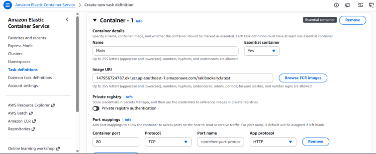

**Step 7:** Scroll to the bottom of the page and click **Create**. The system will redirect and show a green status "Task definition successfully created".

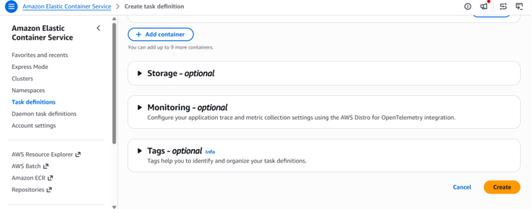

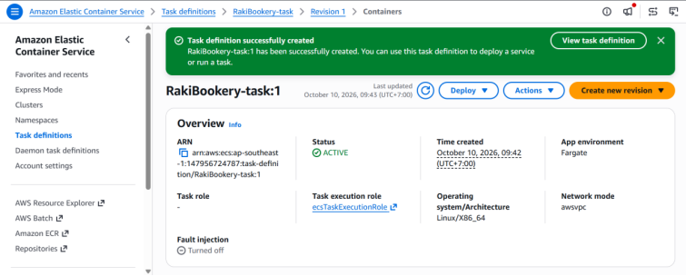

## 3. Assign IAM Permissions for ECS

Open a new tab, navigate to the **IAM (Identity and Access Management)** service, and select **Roles**.

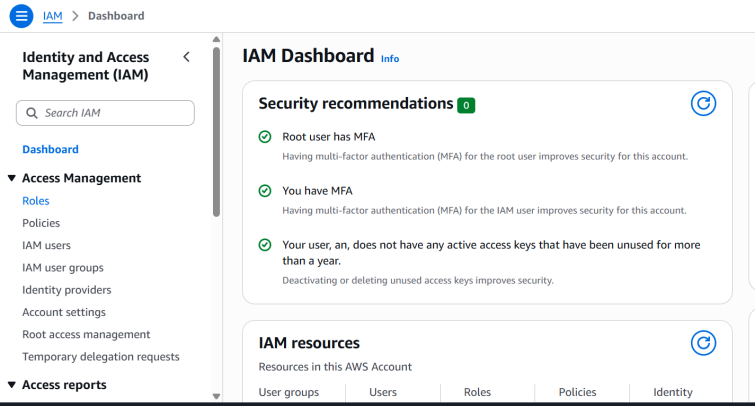

Search for and click on the role named `ecsTaskExecutionRole`.

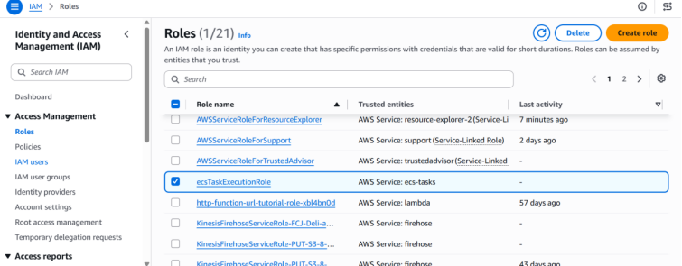

In the **Permissions** tab, select **Add permissions** -> **Create inline policy**.

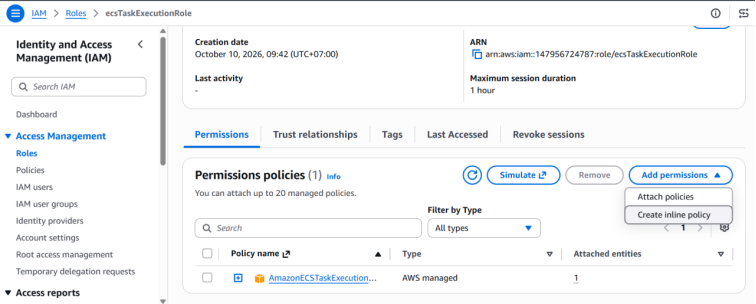

Using the JSON editor, enter a policy granting Allow permission for the 2 Actions `secretsmanager:GetSecretValue` and `kms:Decrypt` on Resource `*`.

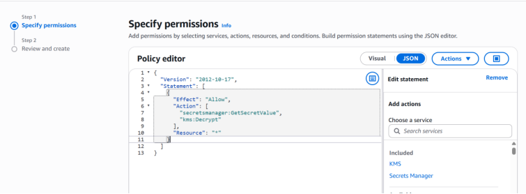
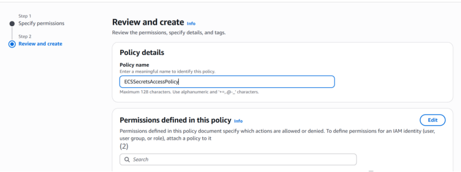

Click **Review and create**, name the policy `ECSSecretsAccessPolicy`, and then click **Create policy**. The message "Policy ECSSecretsAccessPolicy created" will appear, confirming successful permission assignment.

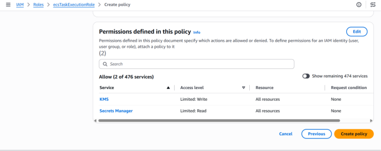

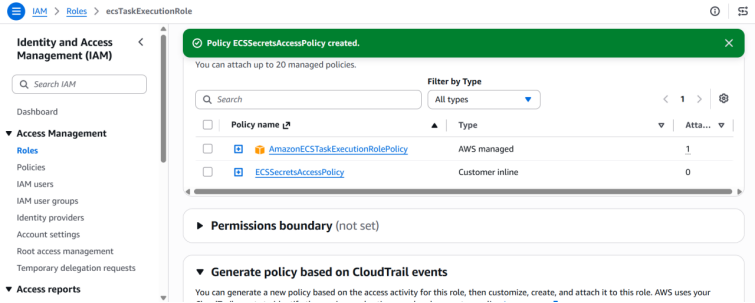

## 4. Retrieve RDS Database Secret Information & Configure env

**Step 1:** Access the AWS **Secrets Manager** service, go to **Secrets**. Click on the secret storing your RDS database information (e.g., `fcj/sprint1/rds/mysql`).

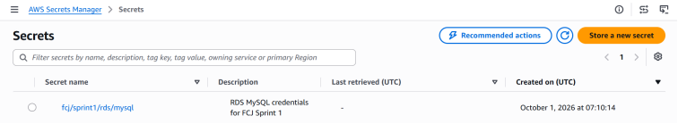

**Step 2:** In the Overview tab, locate the **Secret ARN** section and copy this entire ARN string.

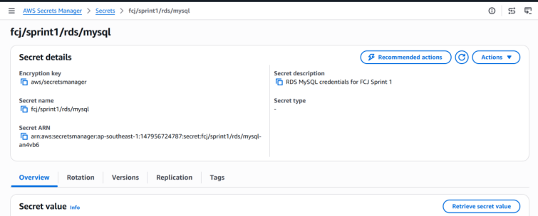

**Step 3:** Return to the Task definitions interface on ECS, click on the `RakiBookery-task` you created.

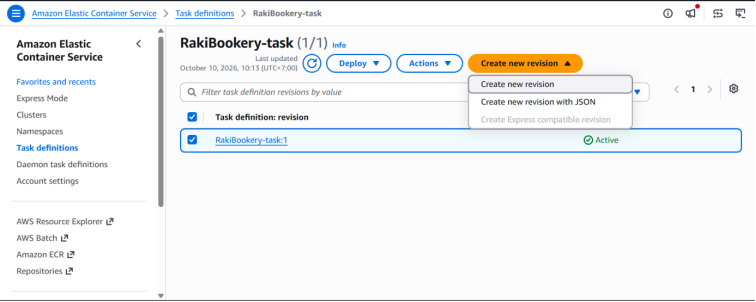

**Step 4:** Click **Create new revision** -> **Create new revision** to update the task configuration.

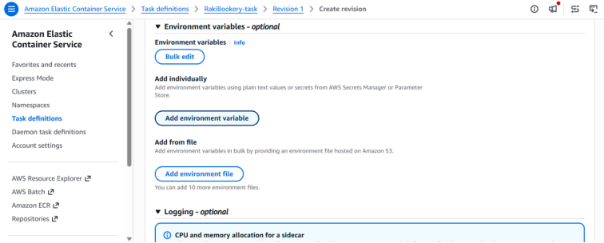

**Step 5:** Scroll down to the Container configuration section, locate **Environment variables - optional**.

**Step 6:** Click **Add environment variable** to sequentially add the variables from your Secret:
- **Variable 1 (Username):** In the Key column, enter `username` | In Value type, select `ValueFrom` | In the Value column, paste the copied Secret ARN.
- **Variable 2 (Password):** In the Key column, enter `password` | In Value type, select `ValueFrom` | In the Value column, paste the same Secret ARN.

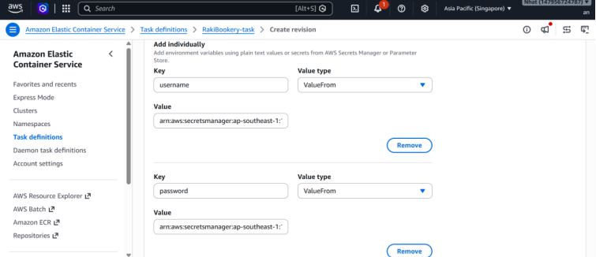

**Step 7:** Double-check the information, then scroll to the bottom and click **Create** to save the new Task Definition Revision.

## 5. Test Launch Task & Check Log

### Test Launch Task:
1. Go back to **Clusters**, and click on the `RakiBookery-cluster`.
2. In the **Tasks** tab, click the **Run new task** button.
3. For **Launch type**, select **Fargate**.
4. Under **Task definition**, select the family `RakiBookery-task` along with the latest Revision (the version with assigned Environment variables).
5. In the **Networking** section, choose your VPC and Subnets (Public Subnets are recommended). Ensure you attach the verified Security Group and that the Auto-assign public IP option is ENABLED.
6. Click the **Create** button to launch the task.

### Check Log:
1. Wait for the task to transition from PROVISIONING -> PENDING -> RUNNING.
2. Click directly on the ID of the running task, and switch to the **Logs** tab.
3. Here, you can verify that the container successfully pulled the image, the application started safely, and it used IAM permissions to read the database connection secrets without throwing any errors.