# Hướng dẫn tạo ECS Cluster và Cấu hình Task Definition

## 1. Tạo ECS Cluster

**Bước 1:** Đăng nhập vào AWS Console, tìm kiếm và truy cập dịch vụ **Amazon Elastic Container Service (ECS)**. Tại thanh menu bên trái, chọn mục **Clusters**.

**Bước 2:** Tại giao diện chính, click vào nút **Create cluster** màu cam.

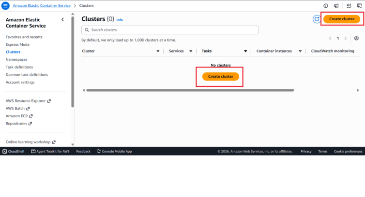

**Cấu hình ECS Cluster:**
Ở phần **Cluster configuration** cấu hình:
- **Cluster name:** `RakiBookery-cluster`
- **Infrastructure:** Fargate only

**Bước 3:** Trong phần Cluster configuration, nhập tên cluster vào trường Cluster name là `RakiBookery-cluster`.

**Bước 4:** Cuộn xuống phần **Infrastructure - advanced**, chọn loại Compute capacity là **Fargate only**. (Đây là môi trường Serverless, không cần quan tâm đến việc khởi tạo hay quản lý các máy chủ EC2)

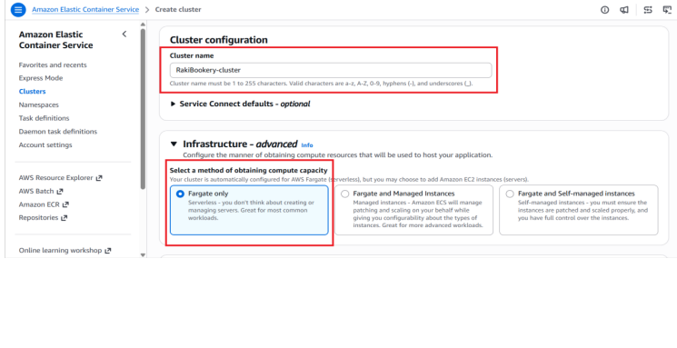

**Bước 5:** Giữ nguyên các thông số tùy chọn khác, kéo xuống cuối trang và click nút **Create** để tiến hành tạo cluster.

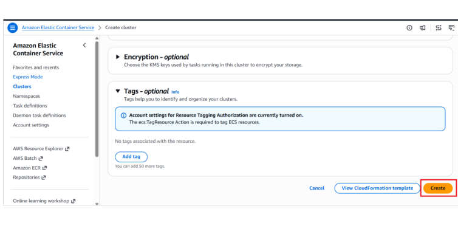

**Bước 6:** Chờ trong giây lát, hệ thống sẽ hiển thị thanh thông báo xanh lá "Cluster RakiBookery-cluster has been created successfully", xác nhận Cluster đã được khởi tạo thành công.

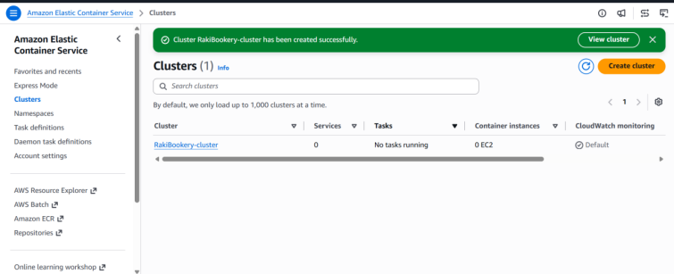

## 2. Tạo Task Definition

**Bước 1:** Tại menu bên trái của dịch vụ ECS, chọn **Task definitions**.

**Bước 2:** Click vào nút **Create new task definition** (có thể chọn thông qua menu dạng thả xuống).

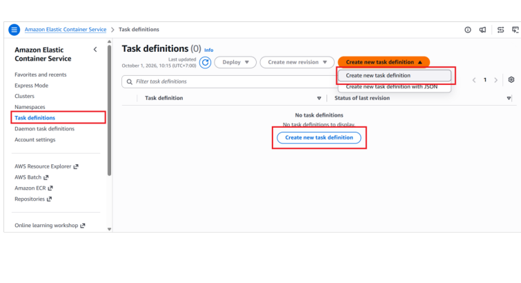

**Cấu hình Task Definition:**

**Bước 3:** Tại phần **Task definition configuration**, nhập tên cho task vào trường Task definition family (ví dụ: `RakiBookery-task`).

**Bước 4:** Tại phần **Infrastructure requirements**, đánh dấu tick vào ô **AWS Fargate** ở mục Launch type.

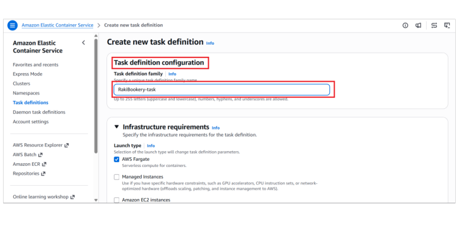

**Bước 5:** Cấu hình tài nguyên máy chủ theo thông số như hình:
- **Operating system/Architecture:** Chọn `Linux/X86_64`.
- **CPU:** Chọn `.25 vCPU`.
- **Memory:** Chọn `1 GB`.

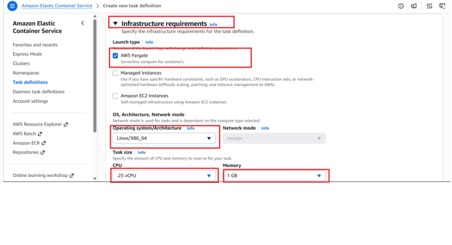

**Bước 6:** Tại phần cấu hình **Container - 1**:
- **Name:** Đặt tên cho container (ví dụ: `Main`).
- **Essential container:** Chọn `Yes`.
- **Image URI:** Dán đường dẫn image đã push lên ECR (ví dụ: `147956724787.dkr.ecr.ap-southeast-1.amazonaws.com/rakibookery:latest`).
- **Port mappings:** Nhập Container port là `80`, Protocol là `TCP`, và App protocol là `HTTP`.

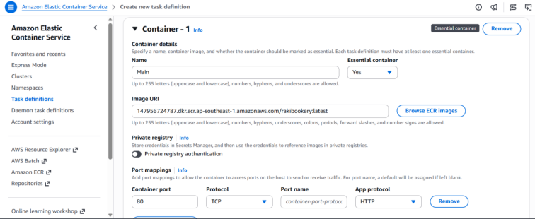

**Bước 7:** Cuộn xuống cuối trang và click **Create**. Hệ thống sẽ chuyển hướng và báo trạng thái xanh lá "Task definition successfully created".

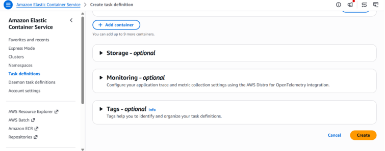

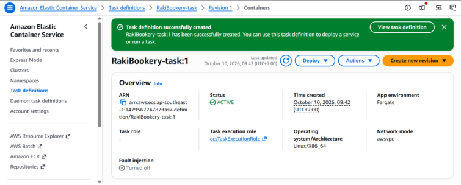

## 3. Gán quyền IAM cho ECS

Mở một tab mới, truy cập dịch vụ **IAM (Identity and Access Management)**, chọn **Roles**.

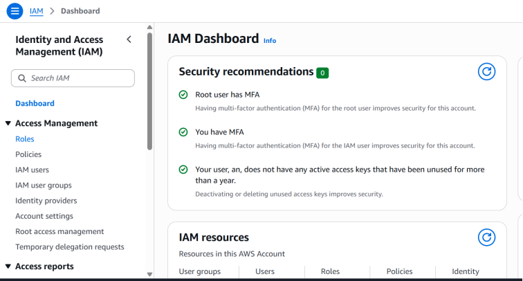

Tìm và nhấp vào role tên là `ecsTaskExecutionRole`.

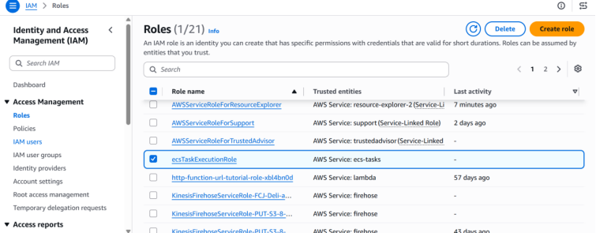

Tại tab **Permissions**, chọn **Add permissions** -> **Create inline policy**.

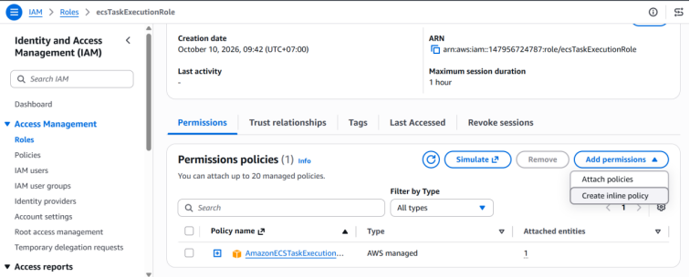

Sử dụng trình soạn thảo JSON, nhập policy cấp quyền Allow cho 2 Action là `secretsmanager:GetSecretValue` và `kms:Decrypt` trên Resource `*`.

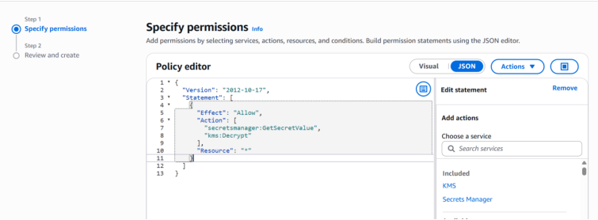
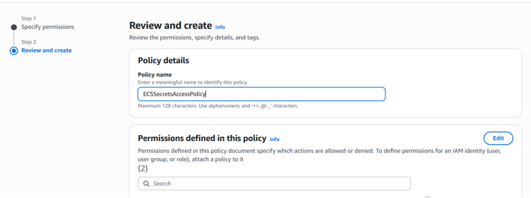

Nhấn **Review and create**, đặt tên cho policy là `ECSSecretsAccessPolicy`, sau đó nhấn **Create policy**. Thông báo hiển thị "Policy ECSSecretsAccessPolicy created" xác nhận việc gán quyền thành công.

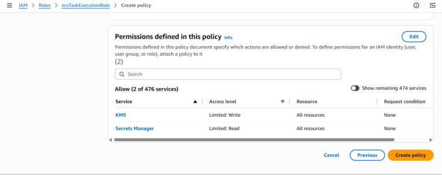

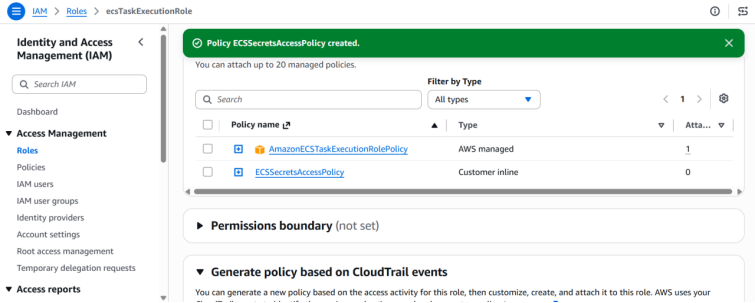

## 4. Lấy thông tin Secret của Database RDS và Cấu hình env

**Bước 1:** Truy cập dịch vụ AWS **Secrets Manager**, vào mục **Secrets**. Nhấp vào secret lưu trữ thông tin của database RDS (ví dụ: `fcj/sprint1/rds/mysql`).

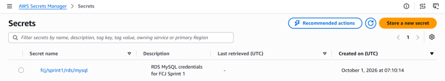

**Bước 2:** Trong tab Overview, tìm mục **Secret ARN** và sao chép toàn bộ chuỗi ARN này.

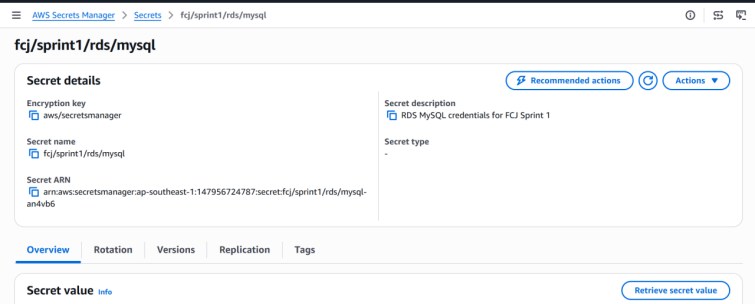

**Bước 3:** Quay trở lại giao diện Task definitions trên ECS, nhấp vào task `RakiBookery-task` đã tạo.

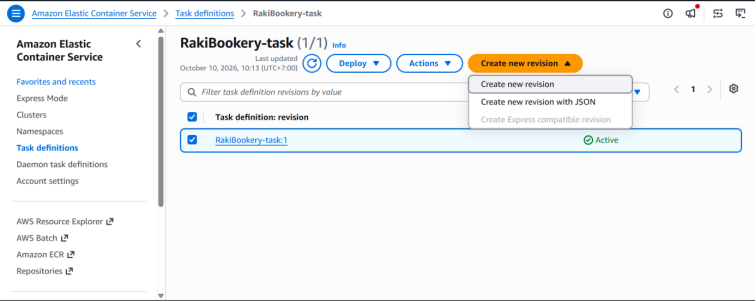

**Bước 4:** Click chọn **Create new revision** -> **Create new revision** để cập nhật cấu hình cho Task.

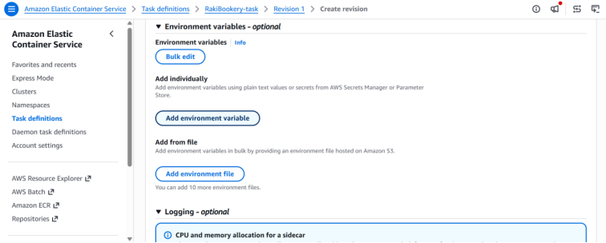

**Bước 5:** Cuộn xuống phần thiết lập cấu hình Container, tìm đến mục **Environment variables - optional**.

**Bước 6:** Nhấp vào **Add environment variable** để thêm lần lượt các biến từ Secret:
- **Biến 1 (Username):** Tại cột Key nhập `username` | Cột Value type sổ xuống chọn `ValueFrom` | Cột Value dán mã Secret ARN vừa sao chép.
- **Biến 2 (Password):** Tại cột Key nhập `password` | Cột Value type chọn `ValueFrom` | Cột Value dán mã Secret ARN tương tự.

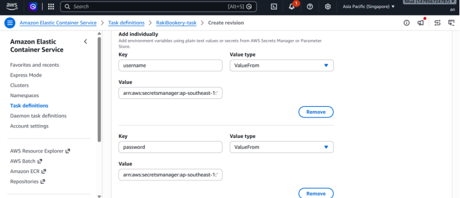

**Bước 7:** Kiểm tra lại thông tin, sau đó cuộn xuống cuối trang và bấm **Create** để lưu lại Task Definition Revision mới.

## 5. Test Launch Task & Check Log

### Test Launch Task:
1. Truy cập lại mục **Clusters**, nhấp vào cụm `RakiBookery-cluster`.
2. Tại tab **Tasks**, nhấp nút **Run new task**.
3. Phần **Launch type** chọn **Fargate**.
4. Ở mục **Task definition**, chọn family `RakiBookery-task` kèm theo Revision mới nhất (phiên bản đã gán Environment variables).
5. Tại phần **Networking**, chọn cấu hình VPC và Subnets (nên chọn Public Subnets). Cấu hình gắn Security Group đã kiểm tra ở bước trên và đảm bảo tùy chọn Auto-assign public IP được bật (ENABLED).
6. Nhấp nút **Create** để hệ thống khởi chạy task.

### Check Log:
1. Đợi task chuyển từ trạng thái PROVISIONING -> PENDING -> RUNNING.
2. Nhấp trực tiếp vào ID của task đang chạy, chuyển sang tab **Logs**.
3. Tại đây, bạn có thể xác nhận container đã pull image thành công, ứng dụng khởi động an toàn và đã dùng quyền IAM để đọc được các secret kết nối tới Database mà không văng ra báo lỗi.