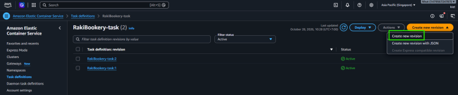
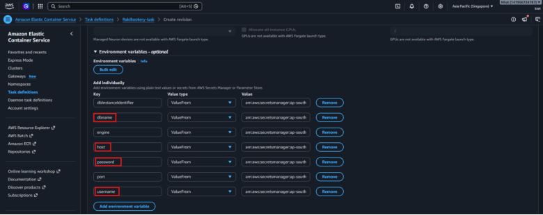
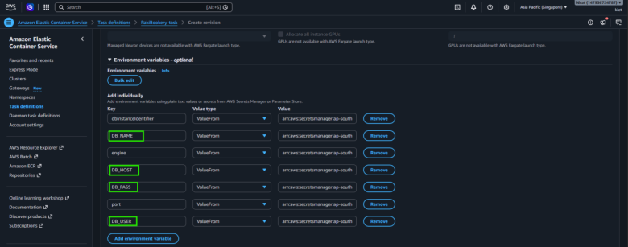
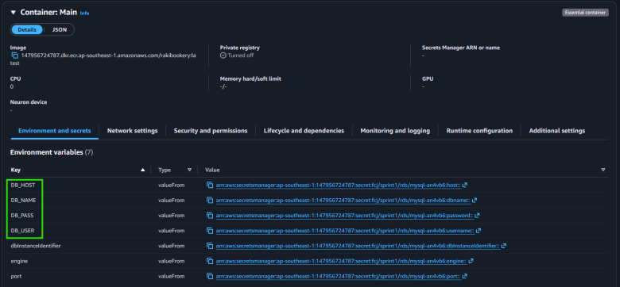

# Kết nối Ứng dụng PHP trên Amazon ECS với Amazon RDS

Tài liệu này hướng dẫn từng bước cách cấu hình biến môi trường từ AWS Secrets Manager, import dữ liệu vào Amazon RDS thông qua một ECS Task độc lập (giữ nguyên tính bảo mật Private cho RDS), xử lý lỗi phân biệt chữ hoa/thường (case-sensitivity) của MySQL trên Linux và kiểm tra kết nối toàn diện qua Application Load Balancer (ALB) và Amazon CloudFront.

---

## Phần 1: Cấu hình Biến môi trường & Secrets Manager cho ECS

Ứng dụng PHP cần đọc thông tin kết nối cơ sở dữ liệu thông qua các biến môi trường chuẩn (`DB_HOST`, `DB_NAME`, `DB_USER`, `DB_PASS`). Chúng ta sẽ ánh xạ các khóa (Key) từ AWS Secrets Manager sang tên biến môi trường tương ứng trong ECS Task Definition.

### Bước 1: Tạo Revision mới và cập nhật tên biến môi trường trong ECS Task Definition

1. Truy cập **Amazon ECS** $\rightarrow$ **Task definitions** $\rightarrow$ chọn **RakiBookery-task**.
2. Nhấn **Create new revision**.

3. Cuộn xuống phần **Container - 1** (Main), tìm mục **Environment variables**.
4. Giữ nguyên giá trị `ValueFrom` (ARN của Secrets Manager), chỉ cập nhật cột **Key** theo bảng ánh xạ sau:

| Key hiện tại | Đổi thành |
| :--- | :--- |
| `host` | `DB_HOST` |
| `dbname` | `DB_NAME` |
| `username` | `DB_USER` |
| `password` | `DB_PASS` |

> **Lưu ý:** Giữ nguyên các biến khác như `engine`, `port`, `dbInstanceIdentifier`, Image URI và Port mappings.


5. Cuộn xuống cuối trang và nhấn **Create** để tạo revision mới (ví dụ: `RakiBookery-task:3`).
6. Kiểm tra lại tại tab **Environment and secrets** trong chi tiết Container để xác nhận các biến đã được cập nhật chính xác.
   

### Bước 2: Cập nhật tên Database trong AWS Secrets Manager

Mặc định khi khởi tạo RDS, trường `dbname` trong Secret có thể mang giá trị `mysql`. Chúng ta cần trỏ chính xác về database của ứng dụng là `bookstoredb`.

1. Mở **AWS Secrets Manager** $\rightarrow$ chọn secret **fcj/sprint1/rds/mysql**.
2. Tại mục **Secret value**, nhấn **Edit**.
   [img5]
3. Chuyển sang tab **Plaintext**, tìm trường `"dbname"` và đổi giá trị từ `"mysql"` thành `"bookstoredb"`.
4. Nhấn **Save** để lưu thay đổi.
   [img6]

### Bước 3: Cập nhật ECS Service để áp dụng cấu hình mới

1. Truy cập **Amazon ECS** $\rightarrow$ **Clusters** $\rightarrow$ **RakiBookery-cluster** $\rightarrow$ tab **Services**.
2. Chọn **RakiBookery-task-service-01** và nhấn **Update service**.
   [img7]
3. Trong mục **Deployment configuration**:
   - **Task definition revision:** Chọn revision mới nhất (ví dụ: `3 (LATEST)`).
   - **Desired tasks:** Đảm bảo giá trị là `1` (nếu đang là `0` thì đổi thành `1`).
   - Tích chọn **Force new deployment** nếu bạn vừa cập nhật giá trị bên trong Secrets Manager mà không tạo revision mới.
   [img8]
4. Nhấn **Update** và chờ cho đến khi Task mới chuyển sang trạng thái **Running**.
   [img9]

---

## Phần 2: Import Dữ liệu vào Private RDS thông qua ECS Fargate Task

Để đảm bảo an toàn bảo mật, RDS được đặt trong Private Subnet và không mở cổng `3306` ra Internet. Thay vì mở public access, chúng ta sẽ đóng gói file `bookstoredb.sql` vào một Docker image tạm thời và chạy một **One-off ECS Fargate Task** nằm cùng VPC với RDS để thực thi lệnh import.

### Bước 1: Chuẩn bị môi trường Docker trên máy Local

1. Đảm bảo máy tính đã cài đặt WSL 2 và **Docker Desktop** (chọn chế độ sử dụng WSL 2).
2. Mở **PowerShell** và kiểm tra Docker hoạt động:
   ```powershell
   docker --version
   docker info
   ```

### Bước 2: Tạo Dockerfile và Build Image chứa dữ liệu SQL

1. Di chuyển vào thư mục gốc của dự án và tạo thư mục con `db-import`:
   ```powershell
   cd D:\Documents\AWS_FCAJ\RakiBookery
   mkdir db-import
   ```
2. Tạo `Dockerfile` bên trong thư mục `db-import`:
   ```powershell
   @'
   FROM mysql:8.0
   WORKDIR /import
   COPY bookstoredb.sql /import/bookstoredb.sql
   '@ | Set-Content -Encoding ascii .\db-import\Dockerfile
   ```
3. Sao chép file `bookstoredb.sql` vào thư mục `db-import` và kiểm tra:
   ```powershell
   Copy-Item .\bookstoredb.sql .\db-import\bookstoredb.sql
   Get-ChildItem .\db-import
   ```
   [img10]
4. Build Docker image với tag `rakibookery-db-import:latest`:
   ```powershell
   docker build -t rakibookery-db-import:latest .\db-import
   ```

### Bước 3: Đẩy (Push) Image lên Amazon ECR

1. Đăng nhập Docker vào Amazon ECR (thay đổi Account ID và Region nếu cần):
   ```powershell
   aws ecr get-login-password --region ap-southeast-1 | docker login --username AWS --password-stdin 147956724787.dkr.ecr.ap-southeast-1.amazonaws.com
   ```
   [img11]
2. Gắn tag ECR riêng (`db-import`) để không ghi đè lên image của ứng dụng web:
   ```powershell
   docker tag rakibookery-db-import:latest 147956724787.dkr.ecr.ap-southeast-1.amazonaws.com/rakibookery:db-import
   docker images
   ```
   [img12]
3. Push image lên ECR:
   ```powershell
   docker push 147956724787.dkr.ecr.ap-southeast-1.amazonaws.com/rakibookery:db-import
   ```
   [img13]
4. Kiểm tra trên **AWS Console $\rightarrow$ Amazon ECR $\rightarrow$ rakibookery** để xác nhận tag `db-import` đã xuất hiện.
   [img14]

### Bước 4: Tạo Task Definition riêng cho tác vụ Import DB

1. Truy cập **Amazon ECS $\rightarrow$ Task definitions $\rightarrow$ Create new task definition**.
   [img15]
2. Cấu hình thông số cơ bản:
   - **Task definition family:** `RakiBookery-db-import-task`
   - **Launch type:** `AWS Fargate`
   - **OS/Architecture:** `Linux/X86_64`
   - **CPU / Memory:** `0.25 vCPU` / `0.5 GB`
   - **Task role:** Để trống (`None`)
   - **Task execution role:** `ecsTaskExecutionRole`
   [img16]
3. Cấu hình **Container - 1**:
   - **Name:** `db-import`
   - **Image URI:** Chọn image `rakibookery:db-import` từ ECR.
   [img17]
   [img18]
   [img19]
   - **Port mappings:** Nhấn **Remove** để xóa cổng `80` (tác vụ chạy ngầm không cần mở cổng).
   [img20]
4. Thêm **Environment variables** trỏ tới Secrets Manager tương tự như ứng dụng chính (`DB_HOST`, `DB_NAME`, `DB_USER`, `DB_PASS`).
   [img21]
5. Cấu hình **Logging** (CloudWatch Logs) với log group `/ecs/RakiBookery-db-import-task`.
   [img22]
6. Tại mục **Docker configuration**, nhập **Entry point** là `sh,-c` và **Command** để nạp dữ liệu từ `/import/bookstoredb.sql` vào RDS:
   ```bash
   mysql -h "$DB_HOST" -P 3306 -u "$DB_USER" -p"$DB_PASS" "$DB_NAME" < /import/bookstoredb.sql
   ```
   *(Sau khi import xong, bạn có thể tạo một revision mới với lệnh `SELECT` để kiểm tra số lượng bản ghi trong database).*
7. Nhấn **Create** để hoàn tất Task Definition.
   [img23]

### Bước 5: Chạy One-off Task để thực thi Import và Kiểm tra Logs

1. Vào **Amazon ECS $\rightarrow$ Clusters $\rightarrow$ RakiBookery-cluster $\rightarrow$ tab Tasks $\rightarrow$ Run new task**.
   [img24]
2. Chọn **Task definition family** là `RakiBookery-db-import-task` (bản `Latest`), **Launch type** là `Fargate`.
   [img25]
   [img26]
3. Tại mục **Networking**:
   - **VPC:** `RakiBookery-vpc-01`
   - **Subnets:** Chọn 2 subnet giống với ECS Service của web.
   - **Security group:** Chọn `RakiBookery-fargate-sg` (Security Group đã được RDS Inbound Rule cho phép cổng `3306`).
   - **Public IP:** `Turned on` (giúp task tải image từ ECR và đọc Secret nếu VPC không có NAT Gateway/VPC Endpoint).
   [img27]
4. Nhấn **Create**. Task sẽ chạy lệnh import và tự động chuyển sang trạng thái **Stopped** sau khi hoàn tất.
5. Mở chi tiết Task vừa chạy $\rightarrow$ tab **Logs** để kiểm tra kết quả. Nếu chạy lệnh kiểm tra dữ liệu, log sẽ hiển thị danh sách các bảng (`book`, `category`, `user`,...) và tổng số bản ghi đã được nạp thành công.
   [img31]
   [img28]
   [img29]
   [img30]
   

---

## Phần 3: Xử lý Lỗi Phân biệt Hoa/Thường (Case-Sensitivity) & Cập nhật Mã nguồn PHP

Khi chạy MySQL trên môi trường Linux (Amazon RDS), tên bảng mặc định **phân biệt chữ hoa và chữ thường** (`lower_case_table_names=0`). Trong khi đó, các bảng trong file SQL được tạo với tên viết thường (`book`, `category`, `order`,...), nhưng một số câu truy vấn trong code PHP lại viết hoa chữ cái đầu (`Book`, `Order`,...).

### Bước 1: Chuẩn hóa tên bảng trong mã nguồn PHP

Kiểm tra thư mục `src/app/models/` và cập nhật toàn bộ tên bảng trong các câu truy vấn SQL sang chữ thường cho 4 file sau:
- `src/app/models/Book.php`
- `src/app/models/Order.php`
- `src/app/models/Address.php`
- `src/app/models/StatisticsModel.php`

### Bước 2: Build và Push Image ứng dụng PHP đã sửa lỗi

1. Tại thư mục gốc dự án (`D:\Documents\AWS_FCAJ\RakiBookery`), build lại Docker image với tag mới:
   ```powershell
   docker build -t rakibookery:rds-casefix-20261030 .
   docker images rakibookery
   ```
   [img32]
2. Đăng nhập ECR, gắn tag và đẩy image mới lên repository:
   ```powershell
   aws ecr get-login-password --region ap-southeast-1 | docker login --username AWS --password-stdin 147956724787.dkr.ecr.ap-southeast-1.amazonaws.com
   docker tag rakibookery:rds-casefix-20261030 147956724787.dkr.ecr.ap-southeast-1.amazonaws.com/rakibookery:rds-casefix-20261030
   docker push 147956724787.dkr.ecr.ap-southeast-1.amazonaws.com/rakibookery:rds-casefix-20261030
   ```
   [img33]
   [img34]
   [img35]
3. Xác nhận tag `rds-casefix-20261030` đã có trên Amazon ECR.
   [img36]

### Bước 3: Triển khai Image mới lên ECS Service

1. Vào **Amazon ECS $\rightarrow$ Task definitions $\rightarrow$ RakiBookery-task $\rightarrow$ Create new revision**.
   [img37]
2. Cập nhật **Image URI** của container chính thành `147956724787.dkr.ecr.ap-southeast-1.amazonaws.com/rakibookery:rds-casefix-20261030`.
   [img38]
3. Giữ nguyên các biến môi trường Secrets Manager (`DB_HOST`, `DB_NAME`, `DB_USER`, `DB_PASS`) và IAM Roles, nhấn **Create** (tạo ra revision mới, ví dụ `RakiBookery-task:5`).
   [img39]
   [img40]
   [img41]
   [img42]
4. Vào **Clusters $\rightarrow$ RakiBookery-cluster $\rightarrow$ Services $\rightarrow$ RakiBookery-task-service-01 $\rightarrow$ Update service**.
   [img43]
5. Chọn **Task definition revision** là bản `Latest` (`5`) và nhấn **Update**. Chờ quá trình deployment hoàn tất.
   [img44]
   [img45]

---

## Phần 4: Kiểm tra Kết nối & Xác minh Hoạt động Website

### Bước 1: Kiểm tra Health Check của Target Group & Truy cập qua ALB

1. Mở **EC2 $\rightarrow$ Target Groups $\rightarrow$ RakiBookery-tg**, kiểm tra tab **Targets** để đảm bảo trạng thái là **Healthy**.
2. Mở **EC2 $\rightarrow$ Load Balancers $\rightarrow$ RakiBookery-alb**, sao chép **DNS name** và truy cập qua trình duyệt (`http://<ALB-DNS-name>`).
   [img46]
   [img47]

### Bước 2: Kiểm tra qua CloudFront & Xử lý tài nguyên tĩnh (CSS/JS) nếu thiếu

1. Mở **CloudFront $\rightarrow$ Distributions $\rightarrow$ RakiBookery-cloudfront**, sao chép **Distribution domain name** (dạng `xxxxx.cloudfront.net`) và mở trên trình duyệt.
   [img48]
2. Nếu giao diện hiển thị thiếu CSS/JS (kiểm tra bằng `F12` $\rightarrow$ tab `Network` thấy lỗi `403` cho các file `.css`/`.js`):
   [img49]
   [img50]
   [img51]
   [img52]
   - Kiểm tra **Origin** của CloudFront để xác nhận bucket S3 lưu trữ static web (ví dụ: `rakibookery-static-web-246111`).
   [img53]
   [img54]
   - Truy cập **Amazon S3**, mở bucket trên và upload thư mục `client/` (chứa `css/` và `js/`) vào bên trong thư mục `assets/` để đạt cấu trúc `assets/client/css/...` và `assets/client/js/...`.
   [img55]
   [img56]
   [img57]
   [img58]
   [img59]
   [img60]
   [img61]
   [img62]
   [img63]
   - Quay lại trang CloudFront và nhấn `Ctrl + Shift + R` để tải lại trang bỏ qua cache.
   [img64]
   [img65]
   [img66]

### Bước 3: Xác minh Truy vấn Dữ liệu từ RDS

Trên giao diện website đã kết nối thành công với RDS, thực hiện kiểm tra các tính năng tương tác cơ sở dữ liệu:
1. **Hiển thị danh sách sản phẩm:** Trang chủ tải đầy đủ 20 đầu sách kèm hình ảnh, tác giả, thể loại và giá bán từ RDS.
   [img67]
2. **Tìm kiếm & Lọc theo tên/thể loại:** Nhập từ khóa (ví dụ: `midnight`, `harry`) và nhấn **Tìm kiếm**.
   [img68]
   [img69]
3. **Lọc theo khoảng giá:** Kéo thanh trượt giá hoặc nhập khoảng giá (`Từ` - `Đến`) và kiểm tra kết quả trả về.
   [img70]
   [img71]
4. **Sắp xếp dữ liệu:** Thử chức năng sắp xếp theo `Giá: Thấp đến cao` và `Giá: Cao đến thấp`.
   [img72]
   [img73]

> **Dọn dẹp sau thực hành:** Sau khi hoàn tất triển khai và kiểm tra, hãy tắt **Docker Desktop** trên máy cá nhân (chuột phải vào biểu tượng Docker ở khay hệ thống $\rightarrow$ **Quit Docker Desktop**) để giải phóng tài nguyên hệ thống.
> [img74]
> [img75]